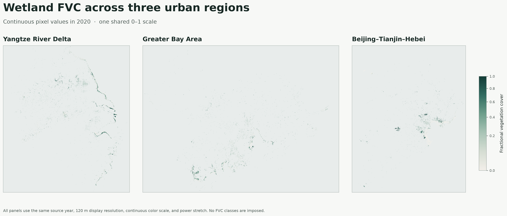
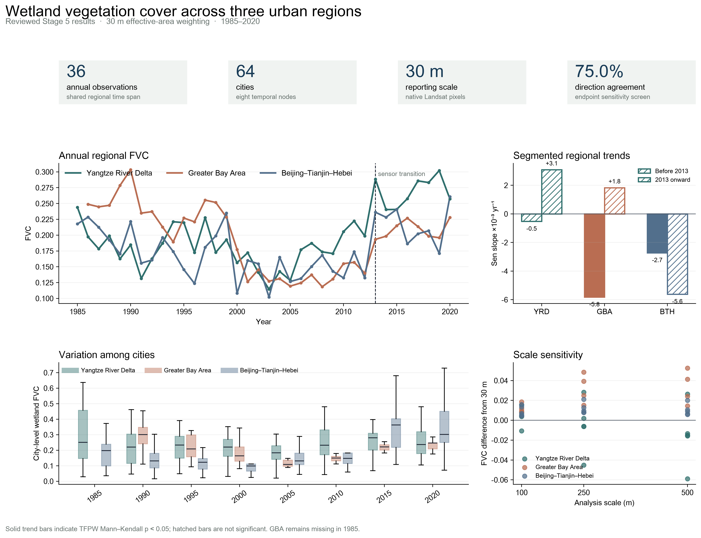
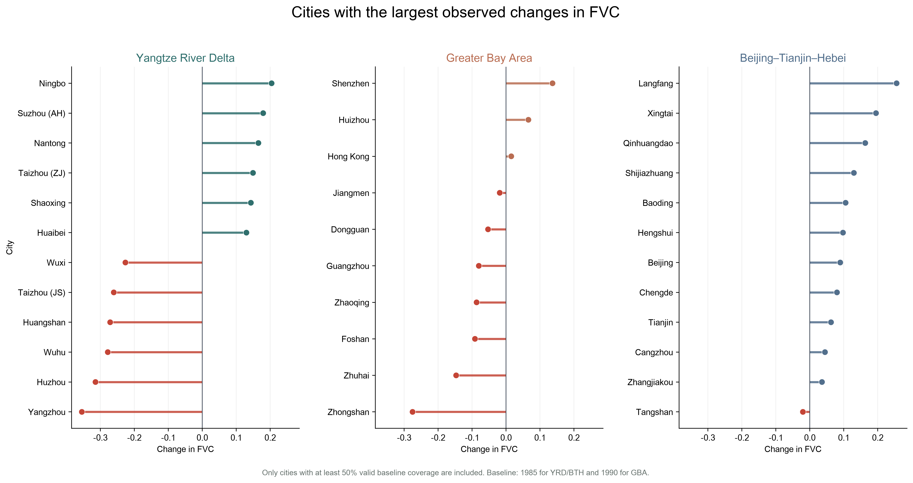
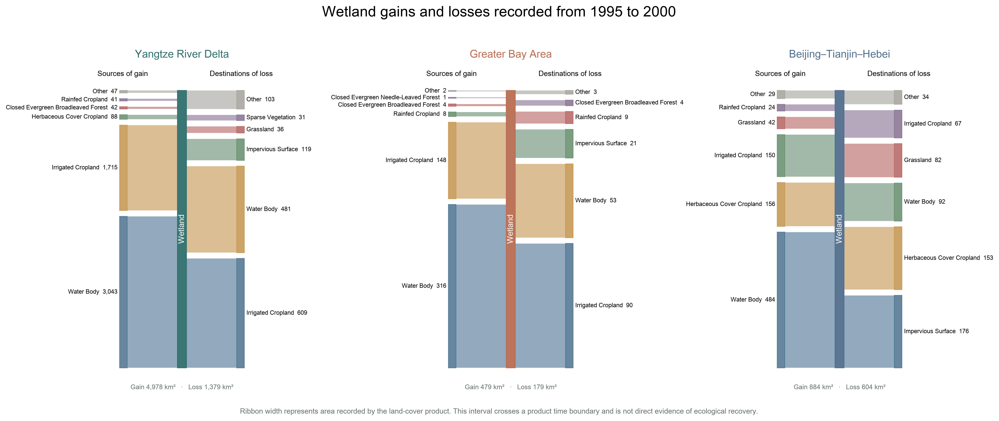

# Wetland vegetation change across three Chinese urban regions

This repository contains the vegetation-cover part of an undergraduate SRDP wetland project. It follows fractional vegetation cover (FVC) in the Yangtze River Delta, Greater Bay Area, and Beijing–Tianjin–Hebei from 1985 to 2020 using Landsat, Google Earth Engine, and Python.



*Continuous FVC values from the three current 2020 spatial display exports. All panels use 120 m source pixels, one continuous 0–1 color scale, and the same power stretch; no FVC classes are created. Thin city outlines from GADM 4.1 provide geographic reference only and are not used in the FVC calculation. Formal regional and city statistics remain based on the reviewed 30 m tables.*

Full-size regional views: [Yangtze River Delta](docs/assets/spatial/yrd_fvc_continuous_2020.png) · [Greater Bay Area](docs/assets/spatial/gba_fvc_continuous_2020.png) · [Beijing–Tianjin–Hebei](docs/assets/spatial/bth_fvc_continuous_2020.png)

The map above is where the project becomes tangible: regional averages can tell us whether FVC changed, but the spatial pattern shows that different wetland systems inside the same urban region did not move together. The repository keeps both views and also records where they cannot be compared directly.

## What I investigated

- How wetland FVC changed across the three regions over 36 years
- Whether the result changes with spatial scale or endpoint choice
- How much variation is hidden by a single regional average
- Which apparent changes coincide with sensor, classification, or coverage boundaries
- Which parts of the original workflow remain useful and which should only be treated as historical diagnostics

## The result used for comparison

The reviewed regional and city tables use a single reporting basis:

- Landsat Collection 2 Level 2 surface reflectance
- QA masking for cloud, cloud shadow, snow, and saturation
- growing-season **median** composites
- pixel-level NDVI and FVC, clipped to `0–1`
- fixed regional endpoints for cross-year comparison
- effective-area weighting at the native **30 m** Landsat scale
- no adjacent-year filling when a region or city is missing

The 500 m workflow and annual dynamic endpoints remain in the repository because they were part of the development process and are useful sensitivity checks. They are not interchangeable with the reviewed 30 m result.

### Evidence status

| Layer | Status | Appropriate use |
| --- | --- | --- |
| `outputs/stage5_final/` regional and city tables | **Reviewed result** | Cross-region and cross-year quantitative comparison |
| Scale, endpoint, coverage, and validation tables | **Supporting evidence** | Robustness checks and qualification of conclusions |
| 2020 continuous maps | **Display products (120 m)** | Spatial context only; not substitutes for 30 m statistics |
| Dynamic-endpoint, 500 m, OLS-class, and fallback outputs | **Historical / diagnostic** | Method development and sensitivity analysis only |

The authoritative scope statement is in [`docs/research_status.md`](docs/research_status.md).



The dashed line marks the 2013 Landsat processing transition. It is shown because a change near that year can contain both ecological and sensor-related effects.

## What the checks changed

Several choices that initially looked like implementation details changed the interpretation:

1. **30 m and 500 m were not equivalent.** Across 14 valid region–year comparisons, the mean absolute FVC difference was `0.022383` and the maximum was `0.058985`. The reviewed regional and city summaries therefore use 30 m.
2. **FVC has to be calculated before aggregation.** Averaging NDVI first and then applying the FVC equation is not the same as calculating pixel FVC and weighting valid pixels by area.
3. **The 1985 comparison is incomplete.** GBA has no valid 1985 result in the reviewed workflow, so it is not filled from a neighbouring year and is not used for a three-region 1985 ranking.
4. **Endpoint choice matters.** Under the 50% baseline-coverage screen, fixed and dynamic endpoints give the same city trend direction for 48 of 64 cities (`75.0%`); 16 direction flips are retained as method-sensitive cases. No city remains significant after the documented within-region FDR correction.
5. **A map and a regional trend test answer different questions.** The continuous 2020 map shows spatial variation at one time point; regional inference uses the annual 30 m tables with segmented Sen slope and TFPW Mann–Kendall tests.

The audit trail and the remaining limitations are documented in [the Stage 5 review](docs/stage5_update_audit_2026.md) and [limitations](docs/limitations.md).
Dataset identifiers, roles, access constraints, and redistribution boundaries are listed in [data sources](docs/data_sources.md).

## Selected views

The figures below are derived from the reviewed tables. They are supporting views rather than substitutes for the underlying CSV files.



The transition figure describes the land-cover classes recorded before wetland gain and after wetland loss. Because 1995–2000 crosses a product time-organization boundary, the ribbons should not be read as direct proof of ecological restoration.



[Figure notes and downloadable PDF versions](docs/assets/publication/README.md)

## Repository map

```text
wetland-fvc-pipeline/
├── gee_scripts/
│   ├── stage5/             # reviewed 30 m export and QA workflow
│   └── *.js                # historical and diagnostic GEE modules
├── python_analysis/src/    # trend tests, validation, and figures
├── outputs/
│   ├── core/               # historical reviewed regional series
│   ├── stage5_final/       # current regional, city, scale, and QA tables
│   ├── analysis/           # derived statistics
│   └── validation/         # cross-check evidence
└── docs/                   # method notes, limitations, and figure assets
```

## Reproduce the reviewed figures

Install the Python dependencies:

```bash
pip install -r python_analysis/requirements.txt
```

Generate the publication figures from the committed Stage 5 tables:

```bash
python python_analysis/src/publication_figures.py
```

Validate the committed public data contract:

```bash
python python_analysis/src/validate_repository.py
```

For fresh Earth Engine exports, run [`gee_scripts/stage5/stage5_final_method_qa.js`](gee_scripts/stage5/stage5_final_method_qa.js) in the GEE Code Editor. The administrative-boundary asset is private; its expected structure and the reconstruction route are described in [`gee_scripts/regions_config.js`](gee_scripts/regions_config.js) and [`docs/limitations.md`](docs/limitations.md).

## Method history

The repository retains failed comparisons and superseded methods on purpose. Two examples shaped the final workflow:

- a shared mutable region variable caused results to depend on execution order; the region factory now isolates each study area;
- an early comparison mixed two different statistical quantities and produced an apparent `1.7–2.2×` discrepancy; aligning the scopes reduced the cross-check to below 10%.

These are described in detail in [`docs/methodology_notes.md`](docs/methodology_notes.md). The point is not that the first version was correct, but that each change can be traced to a specific failure, test, and revised interpretation.

## Data boundary

Raw Landsat and GLC_FCS30D imagery are not committed. The public repository contains aggregate CSV evidence, scripts, and selected figures. Some raster analyses require upstream GEE exports that are too large or dependent on private geometry assets to reproduce from a public clone alone.

Code is released under the [MIT License](LICENSE). Landsat, GLC_FCS30D, OpenStreetMap, CARTO, and other external data remain under their original terms.

See the [changelog](CHANGELOG.md) for the distinction between the reviewed Stage 5 release and the retained historical workflow.
